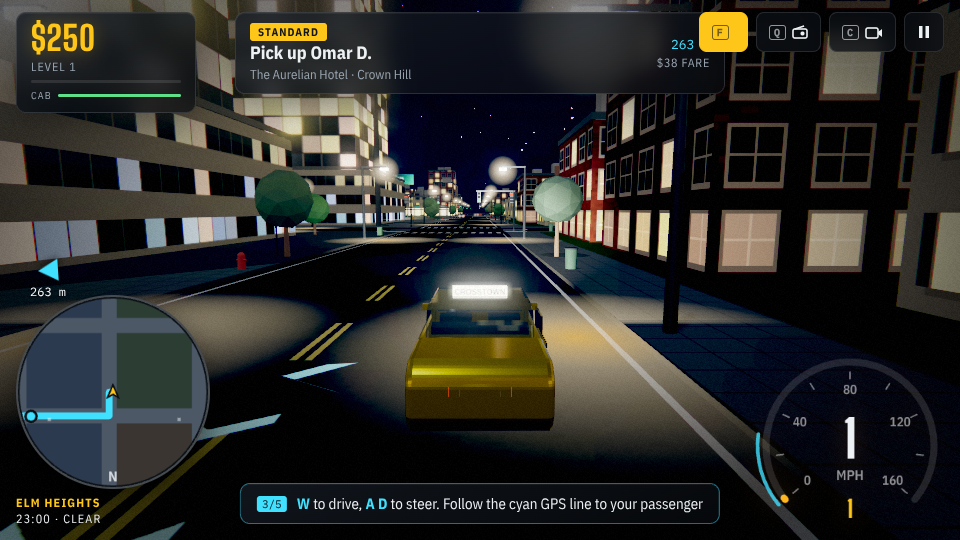
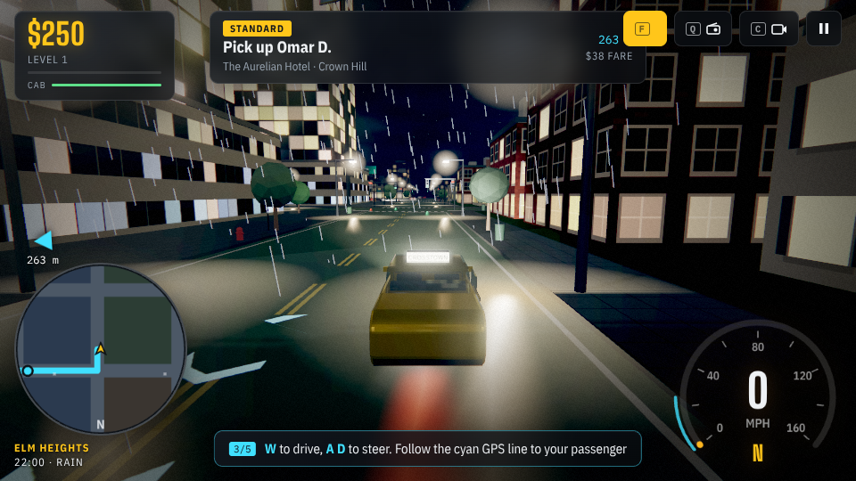

# Crosstown — Vale Harbor Fares

  

<b><a href="https://jmzidek9.github.io/GTA-taxi-game/">jmzidek9.github.io/GTA-taxi-game</a></b> Free, in your browser — phone, tablet or computer. Nothing to install.

A 3D taxi game set in a city that never sees daylight. Take a fare from dispatch, stop by your passenger, watch them climb in, then beat the meter to their destination — without picking up a wanted level on the way.

## Play in 10 seconds
1. Open **https://jmzidek9.github.io/GTA-taxi-game/**
2. Tap **Start driving**
3. Tap **Fares**, pick a passenger, and follow the glowing line

**Put it on your phone like an app:** open the link, then on iPhone tap **Share → Add to Home Screen**; on Android tap **⋮ → Add to Home screen** (or **Install app**). It works offline after the first visit.

## Controls
- **Keyboard:** W/S gas and brake, A/D steer, Space drift, E let passenger in/out, F fares, Q radio, C camera, R reset car, H horn, Esc pause
- **Phone:** drag the steering pad, hold Gas/Brake, tap the yellow prompt to board
- **Gamepad:** stick steers, RT gas, LT brake, A interact, Y camera, X fares, RB radio, LB horn

## Features
- **Fares:** ten fare types, including Sightseer and Follow That Car (tail a car without losing it, then drop off). Every passenger has a personality — nervous, impatient, chatty, tourist or party crowd — that changes what costs and earns their tip.
- **Police:** running reds, speeding past a cruiser, crashing into traffic or hitting a pedestrian raises your wanted level. Patrol cars join the chase; break line of sight to escape, or get boxed in and busted. Red-light cameras send fines that come off your next fare.
- **Living streets:** pedestrians wait for the walk signal, cross at crosswalks, jaywalk, dive out of the way, and get knocked down if you don't stop. Traffic brakes for them.
- **Your cab:** you start in a black Vanta GT sports car. Persistent damage with dents, dulling paint and a smoking engine; a damaged cab earns smaller tips and loses power. Repair, upgrade and repaint in the garage (5 cars).
- **Daily goals** (three per day), first-shift coaching, three procedural radio stations.
- **Looks:** HDR bloom and film grade, headlight beams, wet-road light reflections and puddles, tire smoke, sparks and rain splashes, city reflections on paint and glass, cinematic title camera, an always-night clock that loops dusk to dawn, and changing weather.

- Progress is saved in the browser (versioned, migrates older saves). Works offline after the first visit.

Built with Three.js r147 (bundled in `vendor/`, MIT); no build step.
